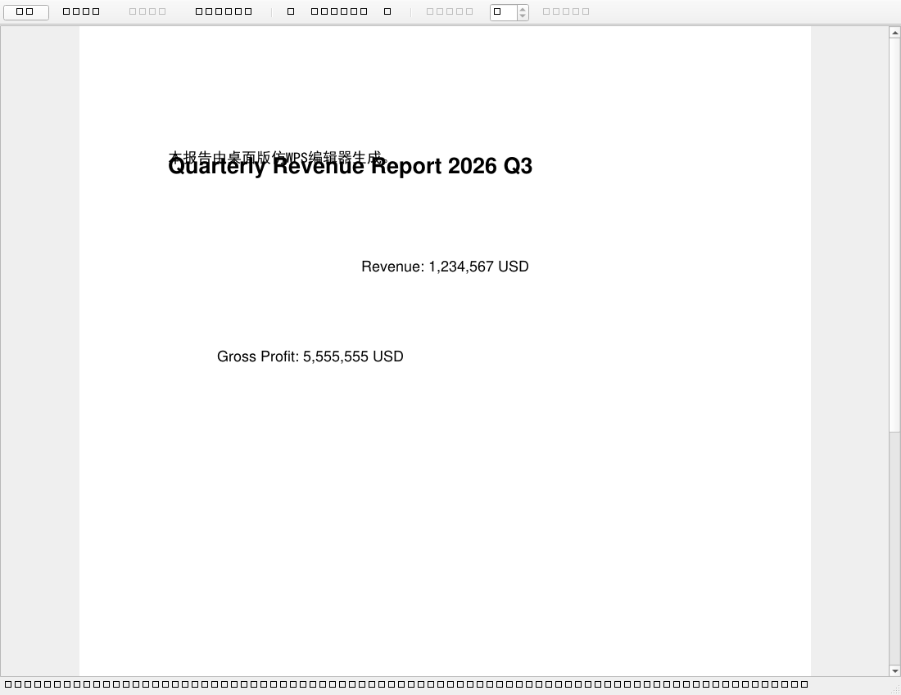
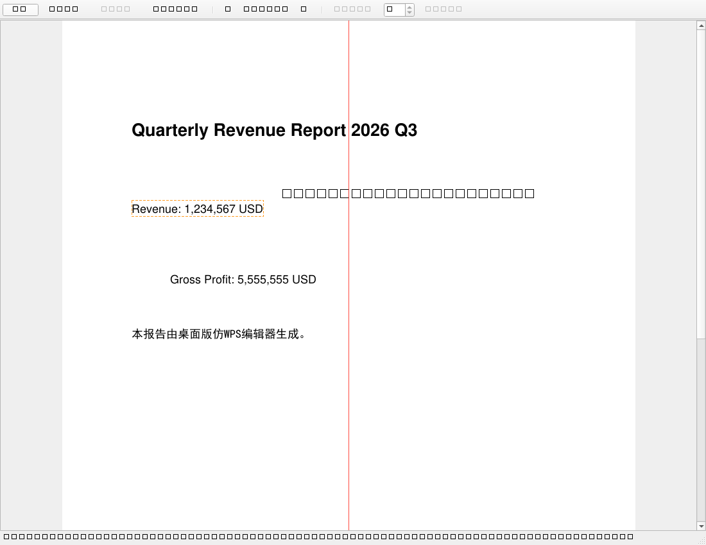

# pdfedit — 仿 WPS 的 PDF 文本编辑器

[English intro below](#english-intro)

一个 Windows 桌面 PDF 文本编辑器：点击文字原位编辑、拖动移动位置（带对齐参考线与吸附）、完整撤销/重做，保存采用**标准增量更新**写回——原文件字节不动，任何阅读器都能打开。

灵感来自对 WPS Office PDF"编辑内容"功能的互操作性研究：PDF 本身没有编辑语义，本项目的做法与 WPS 相同——把页面对象重建为可编辑模型（span 定位 + 背景采样 + redaction 真删除原文字 + 新字体子集嵌入 + 增量写回）。



## 功能

| 功能 | 说明 |
|---|---|
| 原位编辑文字 | 点击任意文字行 → 原位输入框 → Enter 确认 / Esc 取消 |
| 拖动移动 | 按住文字拖动，原位虚线框 + 幽灵预览；单击（不拖）= 编辑 |
| 对齐参考线 | 拖动时自动检测与其他文字行的左缘/中线/右缘、顶边/**文字基线**/底边及页面中线对齐，8px 内吸附并显示红色参考线（同 WPS/PPT） |
| 撤销/重做 | Ctrl+Z / Ctrl+Y，编辑与移动统一事务栈 |
| 增量保存 | Ctrl+S：会话内无论编辑多少次，永远只追加**单层**增量更新（strip-and-reappend），原字节不动 |
| 字体保真 | 四级策略：① 复用 PDF 内嵌完整字体程序（真·原字体）② 嵌入系统同族字体 ③ base-14 度量兼容 ④ 中文黑体/西文 Helvetica 兜底；写入前字形覆盖预检，杜绝"改字变方框" |
| 其他 | Ctrl+滚轮缩放、多页翻页（PgUp/PgDn）、关闭时未保存提醒 |



## 快速开始

**方式一：下载 Release（无需 Python）**

从 [Releases](../../releases) 下载 `pdfedit-1.0-分享版.zip`，解压后双击 `pdfedit.exe`。仅支持 Windows 10/11 64 位；首次运行 SmartScreen 提示"仍要运行"即可（未签名）。

**方式二：源码运行**

```bash
pip install -r requirements.txt
python app.py 你的文件.pdf     # 或不带参数，启动后 Ctrl+O 打开
```

另附 Web 版（`python server.py 文件.pdf` → http://127.0.0.1:8765 ，零前端依赖）。

## 架构

```
core.py     编辑引擎：基线字节不可变 + 操作 journal + 重放指针
            （undo/redo 天然正确；保存 = 剥离旧层后追加单层增量）
app.py      PySide6 桌面界面（页面画布 / span 命中 / 原位编辑 / 拖拽吸附）
server.py   Web 界面（标准库 http.server，内嵌单页）
```

编辑模型（覆盖重绘法的增强版）：

```
定位 span → 渲染周边采样背景色 → redaction 真删除原文字对象（重写内容流）
→ 按原字号/颜色/基线写入新文字（四级字体策略 + 唯一别名嵌入）
→ 增量追加写回
```

## 测试

三个套件共 46 项检查，全部可通过：

```bash
python selftest_core.py          # 引擎 15 项：编辑/撤销/保存结构/双引擎渲染
python test_app_offscreen.py     # 界面 25 项：offscreen 真实 Qt 事件（点击/拖拽/吸附）
python test_font_fidelity.py     # 字体 6 项：内嵌全字体复用 / Arial 真文件
```

## 已知边界

- span 级替换（整行重写），span 内光标级连续输入未实现
- 不支持加密 PDF、XFA；复杂多栏版面未专门适配
- 移动仅平移单个文字行；表格线/图片不参与对齐候选
- 跨会话保存按 Adobe 惯例链式叠层（会话内保持单层，与 WPS 一致）
- 字体：原字体为子集嵌入且本机无同族字体时（出版级商用字体常见），中文回退黑体——WPS/Acrobat 同场景同样只能替换

## Roadmap

- [ ] span 内光标级连续编辑（contenteditable 式）
- [ ] 等距分布参考线（spacing guides）
- [ ] 图片/表格线参与对齐候选
- [ ] OCR 扫描件编辑（PaddleOCR 外置 worker，架构已预留）
- [ ] 内核可选 PDFium（Apache-2.0）版本，去除 AGPL 传染性，便于商用分发

## 许可

本项目代码以 [AGPL-3.0](LICENSE) 发布——因为引擎 [PyMuPDF/MuPDF](https://pymupdf.readthedocs.io/) 为 AGPL，随源码分发时这是最顺的选择。闭源商用需购买 MuPDF 商业授权，或等待上述 PDFium 内核版本。界面库 [PySide6](https://www.qt.io/) 为 LGPL-3.0（动态链接，无传染）。

---

## English intro

A Windows desktop PDF text editor with WPS-style inline editing: click any text to edit in place, drag to move with alignment guides & snapping, full undo/redo, and **standards-compliant incremental save** that never touches the original bytes. Built with Python + PyMuPDF + PySide6. The editing model (span locate → background sampling → true redaction removal → font-subset re-embedding → incremental write-back) mirrors how commercial PDF editors actually do it. AGPL-3.0 licensed (MuPDF engine); see 许可 above.
